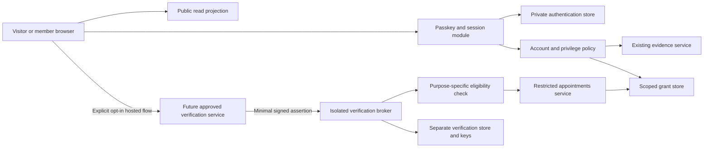

# Identity architecture proposal

## Independent domains

| Domain               | Meaning                                                   | Must not imply                                                          |
| -------------------- | --------------------------------------------------------- | ----------------------------------------------------------------------- |
| Authentication       | Control of a registered passkey and valid session         | Legal identity, uniqueness of a human, or trustworthiness               |
| Account identity     | Internal immutable account ID and public pseudonym        | A legal name or a transferable reputation                               |
| Private verification | Minimal, expiring attestation from an approved process    | Public badge, truth, or exemption from rules                            |
| Reputation           | Explainable, contestable records of participation/conduct | Hidden behavioral profile, identity confidence, or vote weight on facts |
| Privileges           | Scoped, revocable reviewer/moderator appointments         | Access to private verification data                                     |
| Evidence credibility | Source quality, relevance, context, competing evidence    | Credibility from the author's identity level                            |

Do not implement a single numeric `verificationLevel` authorization check. An active member may have no verification, a revoked attestation, or separate reviewer and moderator grants. Claim review still requires rationale and revisions; verification cannot set, rank, recommend, or resolve claim status. No reputation scoring algorithm is proposed.

## Trust boundaries

Keep the core as a modular monolith. The broker is a deliberately small isolation boundary, required before any real provider integration: independent process identity, network policy, PostgreSQL role/database, encryption keys, and restricted deployment access. Application and ordinary moderator credentials cannot query that store. A shared Prisma client or merely hidden UI fields is insufficient. Infrastructure operators are a residual threat; require audited, two-person break-glass access and never give the broker raw identity documents either.

The browser may only receive its own coarse verification state through a private, no-store owner endpoint. Public profile DTOs contain pseudonym and active public role appointments, never verification state, provider, timestamps, reason codes, subject handles, or eligibility predicates. Ordinary moderators see account restrictions and their authorized cases only. Appointments personnel receive a purpose-bound `eligible/not eligible/pending` result without underlying evidence. Dedicated verification/privacy stewards can inspect minimal receipt metadata for a case; their appointment is independent of moderator/reviewer status. No staff can retrieve legal identities from Ground Zero because it never collects them.

## Passkeys and pseudonyms

Use discoverable WebAuthn credentials, HTTPS, explicit production RP ID/origin allowlists, user verification required, and attestation preference `none`. Store public keys and opaque credential IDs, not authenticator biometric data. A passkey can be unlocked by a device PIN; do not require a biometric modality or infer one. Synced passkeys are permitted for members. Validate challenge, type, origin, RP hash, signature, user-presence/verification flags, credential ownership, and permitted algorithms using a maintained library. Treat counter anomalies as a risk signal; some authenticators have non-incrementing counters, so do not auto-ban on counter value alone. [Protocol reference](https://www.w3.org/TR/webauthn-3/).

Challenges: 256 random bits, five-minute TTL, purpose and browser ceremony binding, one atomic consumption. Registration reserves a normalized handle for at most ten minutes; create account and credential in one transaction only after verified ceremony. Account IDs and WebAuthn user handles are random and contain no personal attributes. No email or phone is required at L1.

Use unique lowercase ASCII public handles (3–30 letters/digits/underscore), reserve staff/system lookalikes, and display the stable handle beside display text. An immutable internal ID prevents handle change from transferring ownership of content. Initially disallow self-service renames; safety exceptions require human review, preserved ownership, and a reserved old handle, with limited public linkage if needed to prevent harm. A pseudonym is not a claim that its owner is a named person or institution.

## Sessions and recovery

Replace the development HMAC cookie with 256-bit opaque random session tokens; store only token hashes. Proposed cookie: `__Host-gz-session`, Secure, HttpOnly, SameSite=Lax, Path=/, no Domain. All mutations require same-origin/CSRF checks; SameSite alone is insufficient. Never put credentials/session tokens in URLs, browser storage, analytics, or logs. Rotate token on authentication, recovery completion, and privilege transition; invalidate the old token atomically. [Session reference](https://cheatsheetseries.owasp.org/cheatsheets/Session_Management_Cheat_Sheet.html).

Member sessions: 24-hour idle and seven-day absolute maximum. Privileged activity requires passkey reauthentication within 15 minutes and a session no older than 12 hours; recovery sessions never satisfy step-up. Each write checks account restrictions, session revocation/expiry, authentication version, and live grant state. Revocation, suspension, credential changes, and recovery completion increment account authVersion and invalidate existing sessions in the same transaction. No JWT containing stale permanent roles. Database outage denies writes and private reads; cached anonymous public evidence remains available.

Offer a second passkey and offline recovery codes at registration. Store keyed hashes of random single-use 128-bit codes, show once, and allow regeneration only after fresh passkey proof (revoking previous codes). Possession of a valid code starts a restricted recovery session, consumes the code atomically, suspends privileged grants, revokes normal sessions, and begins a 24-hour hold. Hold expiry alone grants nothing: the bound recovery session must prove a newly enrolled passkey before activation. Existing passkey holders may contest/cancel; cancellation revokes pending credentials/session and requires fresh authentication. No recovery by email alone, security questions, staff discretion, reputation, or L2 identity assertion. Loss of every passkey and code can mean permanent account loss; disclose this before participation and offer accessible setup assistance. [Lifecycle guidance](https://pages.nist.gov/800-63-4/sp800-63b.html).

## Optional verification and privileged appointments

No provider is selected. A future provider must host any sensitive process entirely outside Ground Zero, provide an accessible non-biometric route, and send only audience-bound, signed, nonce-bound, short-lived assertions with opaque pairwise subject, coarse assurance category, issue/expiry times, and transaction ID. No legal name, birth date, document number/image, address, selfie, biometric template, or raw report may enter storage/logging. Reject extra fields at the broker before persistence; disable request-body capture there. Verify issuer, audience, signature/key rotation, expiry, account-bound transaction state, and single use. Do not accept browser-asserted success. A successful assertion never logs the user in or recovers an account.

Broker stores only an HMAC of a provider-specific pairwise subject for limited duplicate detection, not a globally reusable identifier. This remains pseudonymous personal data. It cannot establish uniqueness across providers, stolen identities, or unverified L1 accounts. Provider outages or opting out leave ordinary L1 participation intact. No public L2 badge. Verification denial does not automatically ban anyone.

Reviewer/moderator appointments require training, conflict disclosure, a documented role-suitability check (private attestation or approved reference-based alternative), and two independent authorized approvers excluding the applicant. Reference review records outcomes/opaque references, not legal names or document copies. A recorded scope, rationale code, training version, and expiry are mandatory; initial term is 90 days. Public notices explain appointment and scope without disclosing the verification route. Bootstrap approvers require a separately reviewed maintainer resolution, never applicant self-approval. No grant through changing an enum or verification callback.

Broker eligibility leases last at most five minutes. Expired/revoked eligibility, training, or grant suspends privileged actions; a broker outage eventually denies only affected privileged actions, not L1 reads/writes. Local grant revocation is immediate on the next write check; external revocation is bounded by the five-minute lease plus upstream detection delay, not instantaneous. Policy, grant, and account rows are locked/rechecked in the mutation transaction so revocation has a defined order relative to an in-flight action. Recovery always suspends grants pending new human approval.
