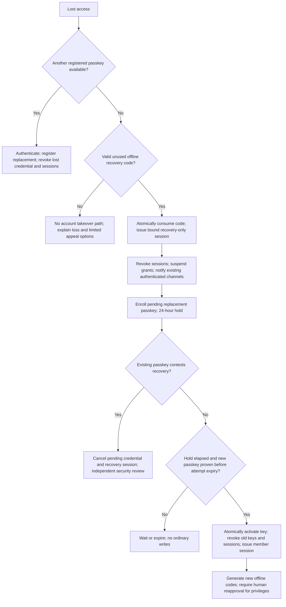

# Gradual identity verification design

**Design proposal only.** No implementation, provider integration, document intake, migration, public registration, or deployment is approved. Anonymous reading and the existing evidence engine remain unchanged.

[Threats and abuse controls](THREAT_MODEL.md) · [Implementation gates and acceptance tests](IMPLEMENTATION.md)

## Policy and approval status

The four levels are policy concepts, not an ascending database role enum. L0 is anonymous reading; L1 is passkey membership with a persistent public pseudonym; L2 is optional private verification; L3 is a separately approved, trained, time-limited reviewer or moderator appointment. L2 never grants moderation/review powers or preferential factual credibility. L3 need not reveal whether someone used L2: role-suitability verification may follow an approved alternative reference-based route. All levels follow the same community rules.

Proposed defaults requiring explicit approval: no public L2 badge; one active pseudonym per account; recovery by a second passkey or an offline single-use code with a 24-hour hold; no email-only or identity-provider-based recovery; 90-day privileged grants; separate verification broker and database credentials; the exact retention and session limits below. No vendor, jurisdictional compliance conclusion, or proof-of-personhood guarantee is selected here.

## Independent domains

| Domain               | Meaning                                                   | Must not imply                                                          |
| -------------------- | --------------------------------------------------------- | ----------------------------------------------------------------------- |
| Authentication       | Control of a registered passkey and valid session         | Legal identity, uniqueness of a human, or trustworthiness               |
| Account identity     | Internal immutable account ID and public pseudonym        | A legal name or a transferable reputation                               |
| Private verification | Minimal, expiring attestation from an approved process    | Public badge, truth, or exemption from rules                            |
| Reputation           | Explainable, contestable records of participation/conduct | Hidden behavioral profile, identity confidence, or vote weight on facts |
| Privileges           | Scoped, revocable reviewer/moderator appointments         | Access to private verification data                                     |
| Evidence credibility | Source quality, relevance, context, competing evidence    | Credibility from the author's identity level                            |

Do not implement a single numeric `verificationLevel` authorization check. An active member may have no verification, a revoked attestation, or separate reviewer and moderator grants. Claim review still requires rationale and revisions; verification cannot set, rank, recommend, or resolve claim status. No reputation scoring algorithm is proposed.

## Trust boundaries

Keep the core as a modular monolith. The broker is a deliberately small isolation boundary, required before any real provider integration: independent process identity, network policy, PostgreSQL role/database, encryption keys, and restricted deployment access. Application and ordinary moderator credentials cannot query that store. A shared Prisma client or merely hidden UI fields is insufficient. Infrastructure operators are a residual threat; require audited, two-person break-glass access and never give the broker raw identity documents either.

The browser may only receive its own coarse verification state through a private, no-store owner endpoint. Public profile DTOs contain pseudonym and active public role appointments, never verification state, provider, timestamps, reason codes, subject handles, or eligibility predicates. Ordinary moderators see account restrictions and their authorized cases only. Appointments personnel receive a purpose-bound `eligible/not eligible/pending` result without underlying evidence. Dedicated verification/privacy stewards can inspect minimal receipt metadata for a case; their appointment is independent of moderator/reviewer status.

## Passkeys and pseudonyms

Use discoverable WebAuthn credentials, HTTPS, explicit production RP ID/origin allowlists, user verification required, and attestation preference `none`. Store public keys and opaque credential IDs, not authenticator biometric data. A passkey can be unlocked by a device PIN; do not require a biometric modality or infer one. Synced passkeys are permitted for members. Validate challenge, type, origin, RP hash, signature, user-presence/verification flags, credential ownership, and permitted algorithms using a maintained library. Treat counter anomalies as a risk signal; some authenticators have non-incrementing counters, so do not auto-ban on counter value alone. [Protocol reference](https://www.w3.org/TR/webauthn-3/).

Challenges: 256 random bits, five-minute TTL, purpose and browser ceremony binding, one atomic consumption. Registration reserves a normalized handle for at most ten minutes; create account and credential in one transaction only after verified ceremony. Account IDs and WebAuthn user handles are random and contain no personal attributes. No email or phone is required at L1.

Use unique lowercase ASCII public handles (3–30 letters/digits/underscore), reserve staff/system lookalikes, and display the stable handle beside display text. An immutable internal ID prevents handle change from transferring ownership of content. Initially disallow self-service renames; safety exceptions require human review, preserved ownership, and a reserved old handle, with limited public linkage if needed to prevent harm. A pseudonym is not a claim that its owner is a named person or institution.

## Sessions and recovery

Replace the development HMAC cookie with 256-bit opaque random session tokens; store only token hashes. Proposed cookie: `__Host-gz-session`, Secure, HttpOnly, SameSite=Lax, Path=/, no Domain. All mutations require same-origin/CSRF checks; SameSite alone is insufficient. Never put credentials/session tokens in URLs, browser storage, analytics, or logs. Rotate token on authentication, recovery completion, and privilege transition; invalidate the old token atomically. [Session reference](https://cheatsheetseries.owasp.org/cheatsheets/Session_Management_Cheat_Sheet.html).

Member sessions: 24-hour idle and seven-day absolute maximum. Privileged activity requires passkey reauthentication within 15 minutes and a session no older than 12 hours; recovery sessions never satisfy step-up. Each write checks account restrictions, session revocation/expiry, authentication version, and live grant state. Revocation, suspension, credential changes, and recovery completion increment account authVersion and invalidate existing sessions in the same transaction. No JWT containing stale permanent roles. Database outage denies writes and private reads; cached anonymous public evidence remains available.

Offer a second passkey and offline recovery codes at registration. Store keyed hashes of random single-use 128-bit codes, show once, and allow regeneration only after fresh passkey proof (revoking previous codes). Possession of a valid code starts a restricted recovery session, consumes the code atomically, suspends privileged grants, revokes normal sessions, and begins a 24-hour hold. Hold expiry alone grants nothing: the bound recovery session must prove a newly enrolled passkey before activation. Existing passkey holders may contest/cancel; cancellation revokes pending credentials/session and requires fresh authentication. No recovery by email alone, security questions, staff discretion, reputation, or L2 identity assertion. Loss of every passkey and code can mean permanent account loss; disclose this before participation and offer accessible setup assistance. [Lifecycle guidance](https://pages.nist.gov/800-63-4/sp800-63b.html).

### Recovery flow and failure handling

Recovery attempts expire after 72 hours; expiry removes pending credentials but does not automatically revive revoked sessions or suspended grants. With no surviving passkey, a new unused recovery code starts a new attempt. Lost recovery-browser binding cannot be bypassed with an email or provider assertion. For contested attempts, staff can freeze or deny but cannot mint a credential on someone's behalf. In-app notices help only holders who still have access; no email is collected by default, so off-device notification is a documented limitation.

If no recovery option is saved, explain permanent-loss risk without forcing identity disclosure. A device without passkey support cannot participate until an accessible compatible method/device is available; anonymous reading must still work. Validate external security keys and assisted onboarding before launch. Registration must obtain acceptance of community rules, apply signup limits, and return safe retry messages without activating an account/session on failure. Confirm understanding of recovery limitations before member tools are offered. Optional verification requires fresh passkey proof and an explicit opt-in before issuing the bound hosted-flow redirect.

## Optional verification and privileged appointments

No provider is selected. A future provider must host any sensitive process entirely outside Ground Zero, provide an accessible non-biometric route, and send only audience-bound, signed, nonce-bound, short-lived assertions with opaque pairwise subject, coarse assurance category, issue/expiry times, and transaction ID. No legal name, birth date, document number/image, address, selfie, biometric template, or raw report may enter storage/logging. Reject extra fields at the broker before persistence; disable request-body capture there. Verify issuer, audience, signature/key rotation, expiry, account-bound transaction state, and single use. Do not accept browser-asserted success. A successful assertion never logs the user in or recovers an account.

Broker stores only an HMAC of a provider-specific pairwise subject for limited duplicate detection, not a globally reusable identifier. This remains pseudonymous personal data. It cannot establish uniqueness across providers, stolen identities, or unverified L1 accounts. Provider outages or opting out leave ordinary L1 participation intact. Verification denial does not automatically ban anyone.

Reviewer/moderator appointments require training, conflict disclosure, a documented role-suitability check (private attestation or approved reference-based alternative), and two independent authorized approvers excluding the applicant. Reference review records outcomes/opaque references only. A recorded scope, rationale code, training version, and expiry are mandatory; initial term is 90 days. Public notices explain appointment and scope without disclosing the verification route. Bootstrap approvers require a separately reviewed maintainer resolution, never applicant self-approval. No grant through changing an enum or verification callback.

Broker eligibility leases last at most five minutes. Expired/revoked eligibility, training, or grant suspends privileged actions; a broker outage eventually denies only affected privileged actions, not L1 reads/writes. Local grant revocation is immediate on the next write check; external revocation is bounded by the five-minute lease plus upstream detection delay, not instantaneous. Policy, grant, and account rows are locked/rechecked in the mutation transaction so revocation has a defined order relative to an in-flight action. Recovery always suspends grants pending new human approval.

## Authorization matrix

Every permission is proposed, deny-by-default, server-enforced, and constrained by account status, action-specific rate limits, object ownership, conflict rules, and valid sessions. “Owner” refers to the currently authenticated account, never a claimed account ID in a form.

| Action                                                    | L0 visitor | L1 member               | L2 member               | Approved reviewer                               | Approved moderator                                | Verification/privacy steward                    |
| --------------------------------------------------------- | ---------- | ----------------------- | ----------------------- | ----------------------------------------------- | ------------------------------------------------- | ----------------------------------------------- |
| Read public claims/sources/history                        | Yes        | Yes                     | Yes                     | Yes                                             | Yes                                               | Yes                                             |
| Submit claim / attach evidence / participate when shipped | No         | Yes                     | Same as L1              | Same as L1                                      | Same as L1                                        | Only via separate member permission             |
| Correct own claim                                         | No         | Yes                     | Same as L1              | Yes                                             | Own only                                          | No extra right                                  |
| Correct another claim / change review status              | No         | No                      | No                      | Scoped, step-up, rationale; no own-claim review | Only with separate reviewer grant                 | No                                              |
| Apply community restriction                               | No         | No                      | No                      | No                                              | Scoped, step-up, reason/appeal route; no own case | No unless separate account-security authority   |
| View own sessions / revoke / export account               | No         | Owner                   | Owner                   | Owner                                           | Owner                                             | Owner                                           |
| Read private verification state                           | No         | Owner coarse state only | Owner coarse state only | Owner only                                      | Owner only                                        | Minimal case-bound metadata                     |
| Read legal identity/documents/biometrics                  | Never      | Never                   | Never                   | Never                                           | Never                                             | Never; not collected                            |
| Decide verification-error appeal                          | No         | No                      | No                      | No                                              | No                                                | Independent steward; no original decision-maker |
| Approve privileged appointment                            | No         | No                      | No                      | No automatic right                              | No automatic right                                | No automatic right                              |

Appointments require a separate `PRIVILEGE_APPROVER` scope and the approval protocol above. Approvers see only the eligibility predicate, not private receipts. Audit readers also need a separate scope; neither reviewer nor moderator includes it. Infrastructure operators have no ordinary application entitlement to personal data.

Account restrictions carry explicit scopes: participation restriction does not deny anonymous reading, managing credentials, viewing own notices, or submitting appeals. Recovery-pending sessions may only finish/cancel recovery and read their own notices. Deletion-pending accounts cannot contribute. Security suspensions revoke sessions; an unguessable case token issued in the restriction/recovery flow permits only a restricted appeal channel, not login or export. Hash and expire case tokens after 30 days; allow a generic unauthenticated appeal request with a one-time case token response that reveals no account existence and never restores access. Human reviewers authenticate ownership before releasing account-specific details.

Moderator actions cannot mutate evidence review labels unless a separately granted reviewer operation is used. No identity attribute changes a claim's evidentiary status. All privileged changes produce a private audit event and a sanitized public explanation where appropriate; private reason codes must never be interpolated into public notices.

## Conceptual schema

Keep existing evidence tables and `User.id` references intact. The current `User.role` is a local-development artifact, not an acceptable production authorization source. Do not apply this proposal to `prisma/schema.prisma` before approval. Types below are conceptual PostgreSQL models; constraints, indexes, migrations, and Prisma mappings must be implemented and reviewed later.

### Core account/auth store

| Model                | Proposed fields and constraints                                                                                                                                                                              |
| -------------------- | ------------------------------------------------------------------------------------------------------------------------------------------------------------------------------------------------------------ |
| User (extend)        | Existing immutable ID; lifecycle enum ACTIVE/RECOVERY_PENDING/SUSPENDED/DELETION_PENDING/DELETED; authVersion bigint; createdAt. Do not infer role from lifecycle.                                           |
| PublicProfile        | userId unique FK; handleCanonical unique; displayText; changeVersion. Public projection only. Handle reservation/tombstone table prevents reuse.                                                             |
| PasskeyCredential    | ID; userId FK; credentialId unique bytes; publicKey bytes; algorithm; counter; backup eligibility/state flags; createdAt/lastUsedAt/revokedAt. No attestation certificate or device fingerprint persistence. |
| AuthChallenge        | ID; challengeHash unique; ceremony type; optional userId; pendingRegistrationId or recoveryAttemptId; browserBindingHash; expiresAt; consumedAt. Conditional atomic consume.                                 |
| PendingRegistration  | random ID/userHandle; handle reservation; expiresAt; no credential until proof. Expiring unique reservation prevents signup races.                                                                           |
| Session              | ID; userId FK; tokenHash unique; authVersion; authMethod PASSKEY/RECOVERY; authenticatedAt/lastSeenAt/expiresAt/absoluteExpiresAt/revokedAt; optional parent recovery ID. No raw token/IP/UA.                |
| RecoveryCode         | ID; userId FK; keyed codeHash unique; keyVersion; generation; consumedAt/revokedAt. Never plaintext.                                                                                                         |
| RecoveryAttempt      | ID; userId FK; state enum; codeId unique; boundSessionId; pendingCredentialId; holdUntil/expiresAt; cancelledAt/completedAt. At most one active attempt per account.                                         |
| AccountRestriction   | ID; userId FK; scope; safe publicReason; private category; issuedBy; startsAt/expiresAt/revokedAt; appealId; version. No verification receipt.                                                               |
| AccountAppeal        | ID; accountId nullable until ownership is established; caseTokenHash; category; state; safe response code; independent assignee; dueAt/closedAt. No attachment or identity free-text field.                  |
| TrainingCompletion   | userId; curriculum/version; assessorId; completedAt/expiresAt. Unique current version per role track.                                                                                                        |
| PrivilegeApplication | ID; userId; scope; state; trainingId; eligibilityLeaseId (opaque); rationaleCode; version.                                                                                                                   |
| PrivilegeApproval    | applicationId; approverId; decision; rationaleCode; createdAt. Unique(applicationId, approverId); applicant cannot approve.                                                                                  |
| PrivilegeGrant       | ID; userId; scope; applicationId unique; validFrom/expiresAt/revokedAt/suspendedAt; version. Require two valid approvals and active training in grant transaction.                                           |
| AccountAuditEvent    | ID; actorId or service principal; targetId; action enum; safe category; timestamp; caseId. Separate from existing claim-linked AuditEvent; no generic JSON payload.                                          |
| ConductEvent         | ID; userId; action category; restriction/appeal reference; expiry; explainable reason. No numeric truth or political-interest score.                                                                         |
| DataRequest          | ID; userId; EXPORT/DELETE; state; dueAt; artifactHandle/expiresAt; holdReference. Restricted worker access.                                                                                                  |

Use FKs and unique/check constraints where possible. Multi-row two-person approval, live revocation, code consumption, and session issuance need transactions and row locks; do not pretend enum fields enforce the protocol. Partial unique indexes enforce one active recovery and overlapping-grant rules where Prisma cannot express them. Mutation idempotency keys are scoped to actor/action and expire after 24 hours. Grant issuance, audit, and application state transition commit atomically. Session token replacement is atomic; a retired token is never accepted in a grace window.

### Isolated broker store

| Model                   | Proposed fields and constraints                                                                                                                                                                              |
| ----------------------- | ------------------------------------------------------------------------------------------------------------------------------------------------------------------------------------------------------------ |
| VerificationLink        | random brokerAccountRef; encrypted core account mapping under a broker-only key; deletion state. Core has no direct FK/query join into this database.                                                        |
| VerificationTransaction | opaque ID; brokerAccountRef; issuer alias; nonceHash/stateHash; requested policy; expiresAt; consumedAt.                                                                                                     |
| VerificationReceipt     | ID; brokerAccountRef; issuer alias; providerPairwiseSubjectHmac + keyVersion; coarse assurance/status enums; issuedAt/expiresAt/revokedAt; policyVersion; assertionDigest. No raw signed assertion retained. |
| BrokerEvent             | issuer + eventId unique digest; processedAt/expiresAt for replay defense. No callback payload.                                                                                                               |
| VerificationAppeal      | ID; brokerAccountRef; receiptId; structured issue code; reviewer; decision code; openedAt/closedAt. No uploaded documents, names, or unrestricted notes.                                                     |
| EligibilityLease        | opaque ID; appointment-purpose reference; eligible boolean; policyVersion; expiresAt (maximum five minutes). Not returned to moderators or public profiles.                                                  |

Only one active receipt for a given issuer/subject token under the selected duplicate policy; contested duplicates go to a private appeal, never silent account merging or public exposure. Key rotation uses a bounded dual-key lookup period; old tokens are rekeyed only when the provider reasserts the subject, otherwise expire/reverify. Do not retain unhashed provider subjects to simplify rotation. Broker/core lifecycle events use an idempotent outbox with acknowledgements and retry; deletion is not complete until both stores acknowledge it.

The schema excludes all sensitive identity fields prohibited above, provider-wide identifiers, and evidence-truth scores. Public citations may name people as part of evidence; they are not a legal-name verification registry. Never repurpose public content or support tickets to collect identity proof.

## Privacy and data lifecycle

All periods below are proposed operational maxima awaiting privacy/security and jurisdiction-specific review, not legal advice or a claim of compliance. The privacy lead owns the schedule; engineering owns enforced TTL/purge jobs; a separate reviewer approves extensions. Publish the final notice before collection. Optional verification requires informed opt-in and an explicit way to withdraw; do not make it a condition of ordinary participation.

### Data minimization and access

No Ground Zero identity UI, API, database, object store, logs, queue, export, or support workflow may accept/store ID scans, legal names as identity attributes, or biometric verification records. Identity forms must warn against submitting sensitive identity material. No document attachments or free-text verification evidence. Use enum-based verification/appeal reasons; substantive document disputes stay with the provider through a separate link. Disable request-body logging, APM payload capture, and callback query-string recording at ingress before using any provider. Test rejection and accidental-intake incident procedures using synthetic canaries only.

A provider may independently process sensitive data only after a future contract and privacy review establishes permitted purposes, non-biometric alternatives, regions, subprocessors, deletion, breach notice, and no advertising/training reuse. Ground Zero must disclose that boundary and cannot promise data never exists at the provider. An opaque provider token is still personal data. Do not call the system anonymous identity verification; it is private pseudonymous attestation.

### Retention schedule

| Data                                          | Maximum proposed retention                                                    | Access / deletion behavior                                                                       |
| --------------------------------------------- | ----------------------------------------------------------------------------- | ------------------------------------------------------------------------------------------------ |
| Auth challenges and handle reservations       | Five and ten minutes respectively; purge within one hour                      | Auth service only; consumed records never reusable                                               |
| Live session hashes                           | Idle/absolute expiry from architecture; purge expired/revoked within 24 hours | Owner sees coarse session list, not hashes                                                       |
| Credentials and recovery code hashes          | Account lifetime or revocation; purge revoked within 24 hours                 | Auth service; no secret export                                                                   |
| Pending recovery                              | 72 hours; purge unactivated keys within 24 hours of expiry                    | Restricted auth workflow; minimal security event survives separately                             |
| Network-prefix rate buckets                   | Rotating key daily; buckets at most 24 hours                                  | Edge abuse service; no raw IP persistence, no cross-day tracking                                 |
| Raw IP/request bodies                         | Transient processing only; no durable application/access-log storage          | Configure ingress/CDN/APM; contract review for vendor infrastructure logs                        |
| Ordinary auth/security audit categories       | 30 days                                                                       | Security staff with case-bound access; no tokens, IPs, raw UA, payloads                          |
| Receipt/subject token                         | Until expiry, withdrawal, or deletion plus seven days to reconcile deletion   | Broker only; default attestation validity at most 12 months pending policy review                |
| Provider event replay digests                 | Seven days, with accepted assertion lifetime at most five minutes             | Broker; old assertions rejected independently of digest deletion                                 |
| Closed verification appeals                   | 90 days after closure                                                         | Privacy stewards; structured reasons only                                                        |
| Restriction/privilege/appeal decision records | 12 months after closure/expiry                                                | Scoped decision/audit staff; sanitized public rationale separate                                 |
| Confirmed serious-abuse subject tombstone     | Optional, at most 90 days, two-person approval and 30-day review              | Broker HMAC only; no automatic ban; notify affected account and allow appeal                     |
| Export artifacts                              | 24 hours; one-time download                                                   | Encrypted, fresh authorization, no public links                                                  |
| Encrypted backups                             | Rolling 30 days                                                               | Restore pipeline reapplies deletion ledger before serving traffic                                |
| Deletion ledger                               | 35 days after live purge, no content                                          | Privacy worker; target IDs only, then purge                                                      |
| Public evidence/history and handle tombstones | No automatic expiry pending redaction/accountability policy                   | Reading preserved; account deletion detaches profile and removes identifying text where required |

No indefinite silent legal hold. Any exceptional hold needs a documented purpose, minimal fields, restricted access, expiry and 30-day review; give notice unless prohibited. The privacy reviewer must resolve conflicts between a valid deletion request, public corrections, and accountability before launch. No automatic promise to delete public copies already downloaded by others.

### Deletion and export

Fresh passkey authentication (or completed recovery followed by fresh passkey proof) authorizes these actions. Restricted members retain these rights subject to narrowly reviewed holds, not moderator convenience. Queue requests with idempotent IDs; target completion within 30 days, not an asserted statutory deadline. On deletion, immediately revoke sessions and grants and close contribution access. Purge credentials, recovery state, private verification link/receipts, and optional contact data if ever introduced. Request provider deletion independently and track acknowledgement; disclose provider delays or applicable retention instead of marking external erasure complete prematurely.

Preserve existing claim/revision ownership with a non-login tombstone User rather than breaking FKs. Remove public profile/display attribution links and apply the separately approved redaction process to personal material, including old revisions. A pseudonym/history can still identify someone; tombstoning is not guaranteed anonymization. Reserve old handles without retaining private verification status. Review public attribution retention before production.

Export only the requester's public contributions and own private account/decision summary via separate authorization paths. Include own coarse verification result and dates, not provider subject tokens, hashes, keys, raw assertions, other users' records, staff private case notes, or third-party personal data. Owners receive reasoned decisions without exposing other people or abuse-detection secrets. Export isolation tests must include redacted appeals and mixed-party discussions.

### Challenges and appeals

Show private verification denials/expiry with a structured reason, provider dispute link, and Ground Zero steward-review route. Do not tell the member which other account matches a duplicate token. An independent steward can correct linkage/process errors or request a fresh assertion, never change provider evidence invisibly. Identity disputes never settle claim truth.

Account restrictions provide a safe rule reference, duration, scope, and appeal instructions. A different authorized human reviews the appeal, records outcome and rationale, and notifies the member through the private case channel. Target acknowledgement within seven days and a decision/update within 30 days; publish staffing limits before launch. An inaccessible account can open a restricted case without being granted login; release account-specific details only after ownership proof. Appeal success removes the relevant restriction but does not by itself authenticate the requester or restore privileged grants.

## References

Consulted October 22, 2026. These inform technical design, not a claim of certification or legal compliance:

- [W3C WebAuthn Level 3](https://www.w3.org/TR/webauthn-3/): relying-party-scoped credentials and verification protocol. Use maintained protocol libraries and conformance tests, not bespoke cryptography.
- [NIST SP 800-63B-4](https://pages.nist.gov/800-63-4/sp800-63b.html): authenticator lifecycle and recovery guidance. Ground Zero is not claiming a NIST assurance level.
- [OWASP Session Management](https://cheatsheetseries.owasp.org/cheatsheets/Session_Management_Cheat_Sheet.html): server-side session lifecycle and cookie protections.

All timeout/retention numbers and governance processes in this package are Ground Zero proposals, not requirements attributed to these references.
