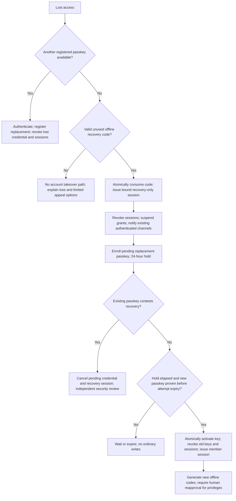

# Registration and recovery flow diagrams

These describe future behavior only. All identity forms must warn against submitting sensitive identity material. Challenge data is never a public account-existence oracle.

## L1 registration

```mermaid
sequenceDiagram
  participant U as Visitor browser
  participant A as Authentication module
  participant D as Account database
  U->>A: Choose persistent public handle; accept rules
  A->>A: Proportionate signup limits; canonicalize/reserve handle
  A->>D: Store expiring bound registration challenge
  A-->>U: Passkey creation options; no attestation requested
  U->>U: Authenticator prompts for local verification
  U->>A: Credential creation response
  A->>A: Validate origin/RP/challenge/UV and credential proof
  alt Invalid, duplicate, expired, or rate limited
    A-->>U: Safe retry message; no active account/session
  else Valid
    A->>D: Atomically consume challenge; create User, profile, credential, session
    A-->>U: Secure cookie; offer second passkey and one-time recovery codes
    U->>A: Confirm recovery limitations understood
    A-->>U: Member tools subject to newcomer quotas
  end
```

If no recovery option is saved, explain permanent-loss risk without forcing identity disclosure. A device without passkey support cannot participate until an accessible compatible method/device is available; anonymous reading must still work. The launch review must validate external security keys and assisted onboarding, not promise universal support.

## Recovery



Recovery attempts expire after 72 hours; expiry removes pending credentials but does not automatically revive revoked sessions or suspended grants. With no surviving passkey, a new unused recovery code starts a new attempt. Lost recovery-browser binding cannot be bypassed with an email or provider assertion. For contested attempts, staff can freeze or deny but cannot mint a credential on someone's behalf. In-app notices help only holders who still have access; no email is collected by default, so off-device notification is a documented limitation.

## Optional verification and appointments

```mermaid
sequenceDiagram
  participant M as Authenticated member
  participant B as Isolated broker
  participant P as Future approved provider
  participant H as Independent approvers
  M->>B: Fresh passkey proof; explicit opt-in
  B-->>M: Bound expiring hosted-flow redirect
  M->>P: Complete private provider process outside Ground Zero
  P->>B: Minimal signed assertion via authenticated callback
  B->>B: Validate and consume transaction; persist allowlisted receipt only
  B-->>M: Own private coarse state or appeal instructions
  Note over B,H: L2 creates no role grant or truth signal
  M->>H: Apply for reviewer/moderator scope and training
  H->>B: Purpose-bound suitability eligibility request
  B-->>H: Short-lived eligibility result only
  H->>H: Two independent decisions; record scope, training, expiry
  H-->>M: Grant or denial with safe rationale and independent appeal
```

The suitability request can use the approved reference-based route instead of L2. Provider denial, pending appeal, outage, or opting out must not disable existing L1 membership. A separate community restriction may do so under the same rules as any account.
